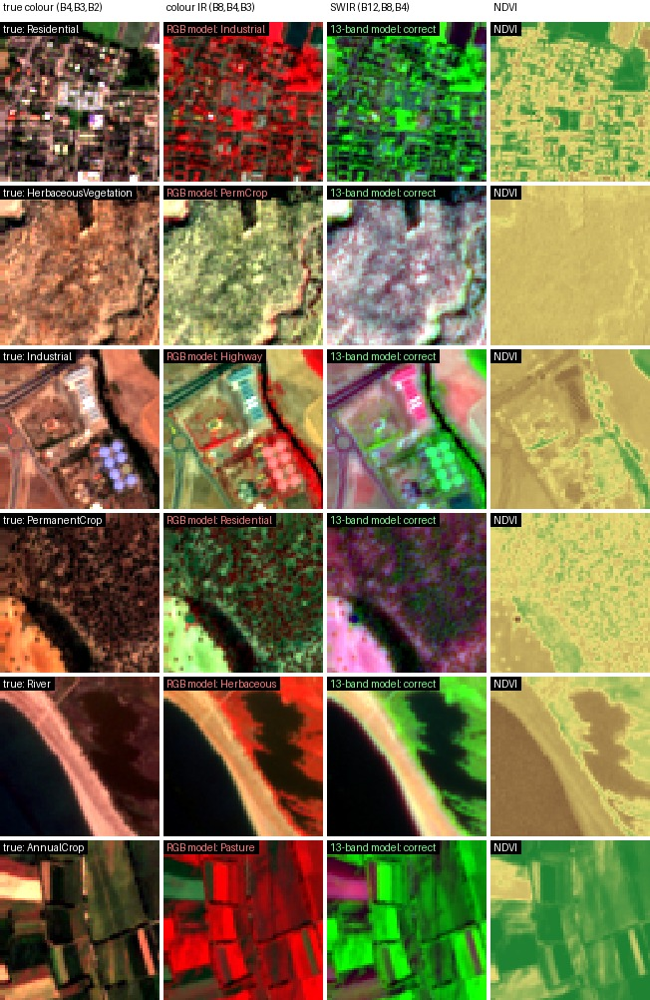
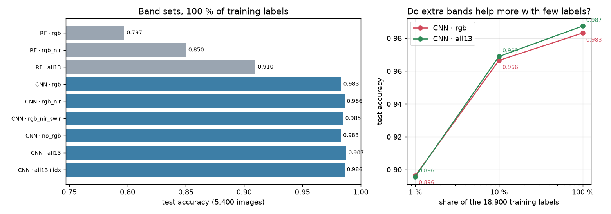
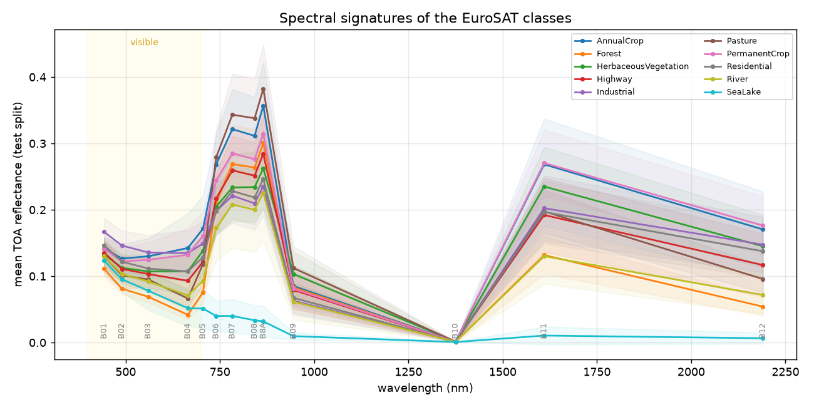
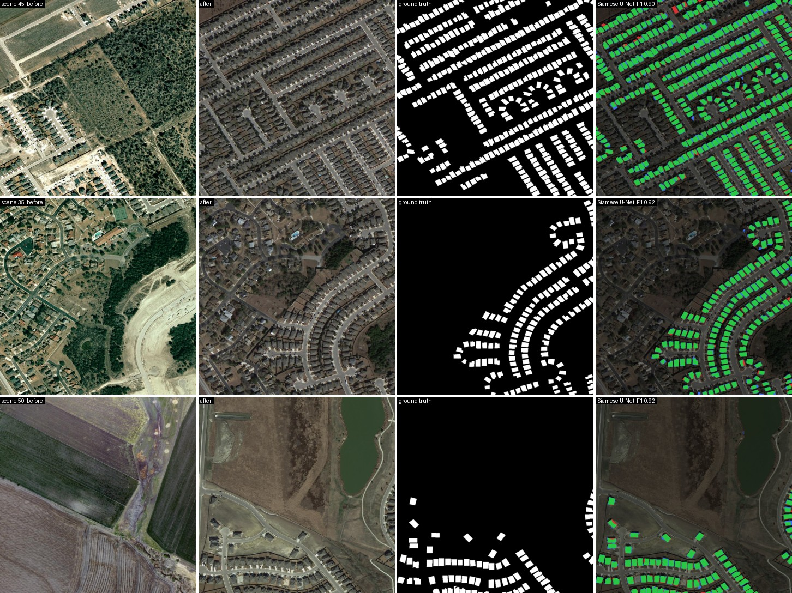
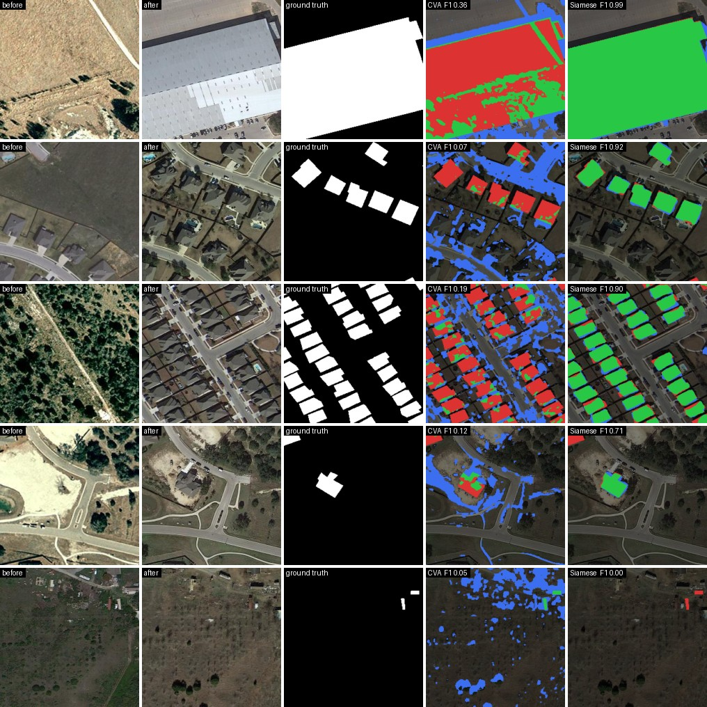
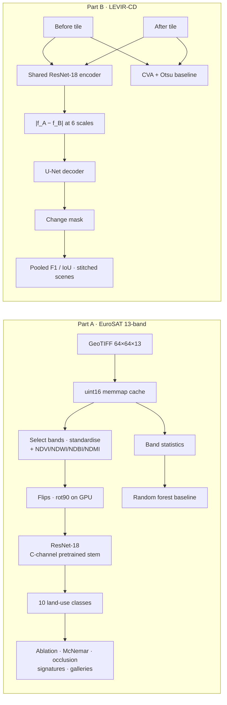

<div align="center">

# 🛰️ Satellite Land Use & Change Detection: what do the extra bands buy?

**Land-use classification on all 13 Sentinel-2 bands (EuroSAT) with a controlled band-ablation study, and building change detection on LEVIR-CD with a Siamese U-Net compared against classical Change Vector Analysis.**

[](https://github.com/haroonkhan02/satellite-landuse-multispectral/actions/workflows/ci.yml)




<sub>Test patches the RGB-only model misclassifies and the 13-band model gets right: true colour · colour infrared · SWIR · NDVI.</sub>

</div>

---

## Highlights

- **All 13 Sentinel-2 bands, used properly.** An ImageNet ResNet-18 gets a rebuilt 13-channel stem: red/green/blue keep their pretrained filters, the other bands start from the mean RGB filter, and the kernel is rescaled by 3/C. Spectral indices (NDVI, NDWI, NDBI, NDMI) are optional extra channels.
- **A real ablation, not one number.** 9 band configurations, a spectra-only random-forest baseline, and RGB vs. all-13 with 1 %, 10 % and 100 % of the labels, all on the same committed split, with a significance test.
- **Building change detection** with a weight-sharing Siamese U-Net that fuses |f<sub>before</sub> − f<sub>after</sub>| at every scale. It is order-invariant by construction, and that symmetry gives a free augmentation. Test F1 **0.890** vs. 0.12 for Change Vector Analysis.
- **Maps, not just metrics.** Spectral signatures per class, band-occlusion importance, colour-infrared/SWIR/NDVI composites with haze removal, and full 1024 px scenes stitched back from their tiles.
- **Tested without data.** 39 unit tests on synthetic spectra and tiles (index physics, band order, stem transfer, Siamese symmetry, Otsu, stitching) run in CI on Python 3.10–3.12.

## Results

Everything below comes from the runs in this repo on an Apple M5 (PyTorch MPS): `satland-ablation`, `satland-evaluate`, `satland-cd-train`, `satland-cd-evaluate`.

### Part A: EuroSAT land use, which bands matter?

Stratified 70/10/20 split of the 27,000 patches ([`configs/eurosat_split.json`](configs/eurosat_split.json)); **test = 5,400 patches**. CNN = ImageNet ResNet-18, 8 epochs, best epoch chosen on validation. RF = random forest on per-image band statistics (mean, std, 10th/90th percentile per band, plus index means/stds), so **spectra only, no spatial context**.

| Model | Bands | Labels used | Test accuracy | Macro F1 | Train time |
|---|---|---|---|---|---|
| Random forest | RGB | 100 % | 0.797 | 0.789 | 0.2 min |
| Random forest | RGB + NIR | 100 % | 0.850 | 0.845 | 0.2 min |
| Random forest | all 13 | 100 % | 0.910 | 0.905 | 0.8 min |
| ResNet-18 | RGB (B4, B3, B2) | 100 % | 0.983 | 0.982 | 2.2 min |
| ResNet-18 | RGB + NIR | 100 % | 0.986 | 0.986 | 2.1 min |
| ResNet-18 | RGB + NIR + SWIR | 100 % | 0.985 | 0.984 | 2.2 min |
| ResNet-18 | 10 non-visible bands only | 100 % | 0.983 | 0.982 | 2.3 min |
| ResNet-18 | **all 13** | 100 % | **0.987** | **0.987** | 2.4 min |
| ResNet-18 | all 13 + 4 indices | 100 % | 0.986 | 0.986 | 2.4 min |
| ResNet-18 | RGB | 10 % (1,890) | 0.966 | 0.966 | 1.2 min |
| ResNet-18 | all 13 | 10 % (1,890) | 0.969 | 0.968 | 1.3 min |
| ResNet-18 | RGB | 1 % (191) | 0.896 | 0.894 | 0.8 min |
| ResNet-18 | all 13 | 1 % (191) | 0.896 | 0.893 | 0.9 min |

<p align="center"></p>

**RGB vs. all 13 bands, head to head on the same 5,400 test patches:** 91 vs. 68 errors (−25 %). 57 patches are fixed by the extra bands and 34 are broken; exact McNemar test p = 0.021. The gains are in the vegetation classes: Pasture F1 0.968 → 0.978, PermanentCrop 0.965 → 0.972, HerbaceousVegetation 0.977 → 0.983, AnnualCrop 0.978 → 0.983. Residential↔Industrial confusions halve (6 → 3).

<p align="center"></p>

**What the numbers say**

- **Spectral information and spatial context are largely interchangeable on EuroSAT.** Without spatial features, the extra bands are worth **+11 points** (RF 0.797 → 0.910). A CNN that sees texture and shape already gets 0.983 from RGB alone, so the same bands add only **+0.4 points**. That's small but statistically real (p = 0.02), and it concentrates exactly where physics says it should: crops, pasture and herbaceous vegetation, whose red-edge/NIR/SWIR signatures differ more than their colours (see the signature plot).
- **The 10 non-visible bands alone match RGB (0.983 vs. 0.983)**, even though their stem filters start from a *mean* RGB filter. Each modality carries enough information on its own.
- **My hypothesis that extra bands help more with few labels was wrong here.** With 1 % or 10 % of the labels, RGB and all-13 score the same (0.896 / 0.896, 0.966 / 0.969). A likely reason: the ImageNet stem only has meaningful filters for RGB, so with 191 images the new channels can't be learned. Pretraining favours the bands it was trained on.
- **Explicit indices didn't help the CNN** (0.986 vs. 0.987). A network with 13 standardised bands can approximate band ratios itself at this data scale.
- **Band occlusion says the trained model leans on the visible bands** (accuracy drops 0.12–0.16 when B2/B3/B4 are blanked, 0.05 for SWIR B11/B12, < 0.02 for each NIR/red-edge band). That isn't "NIR is useless": the five NIR/red-edge bands are highly correlated, so blanking any *one* of them is compensated by the others. Occlusion measures non-redundant reliance, not information content. ([`band_importance.png`](reports/band_importance.png))

> **Caveats.** One seed per configuration; the differences between 0.983 and 0.987 are within run-to-run noise except for the McNemar-tested RGB vs. all-13 pair. Validation accuracy was still creeping up at epoch 8 (0.986), so longer schedules would lift every row a little. EuroSAT's random split lets neighbouring patches of the same field land in train and test, which flatters every model; a geographic split would be stricter.

### Part B: LEVIR-CD building change detection

Official LEVIR-CD split (445 / 64 / 128 scenes of 1024² px at 0.5 m) as 256² tiles: **test = 2,048 tiles**, 5.1 % changed pixels. Metrics are for the *change* class, pooled over all test pixels (the LEVIR-CD convention). Siamese U-Net: ResNet-18 encoder (ImageNet), 10 epochs, 37.5 min on the M5; the best validation F1 (0.894) came at the last epoch.

| Method | F1 ↑ | IoU ↑ | Precision | Recall | ms / 256² tile |
|---|---|---|---|---|---|
| CVA + Otsu per tile (unsupervised) | 0.105 | 0.055 | 0.064 | 0.290 | 4.3 (CPU) |
| CVA + threshold tuned on val | 0.117 | 0.062 | 0.073 | 0.284 | 4.3 (CPU) |
| **Siamese U-Net (\|f<sub>A</sub> − f<sub>B</sub>\|)** | **0.890** | **0.801** | 0.891 | 0.888 | 5.9 (MPS) |

- Median per-tile F1 on the 923 tiles that contain change: **0.895** (CVA 0.152) · [`cd_tile_f1.png`](reports/cd_tile_f1.png)
- On tiles with **no** change, the model flags ≥ 50 pixels in 4.1 % of them.

<p align="center"></p>
<p align="center"><sub>Three full test scenes stitched from 16 tiles each: before · after · ground truth · prediction (green = correct change, red = missed, blue = false alarm). In the bottom scene, fields became a lake and new roads appeared. The network ignores all of it and marks only the houses.</sub></p>

<p align="center"></p>
<p align="center"><sub>Tiles from best to worst: CVA (4th column) fires on every road, shadow and patch of vegetation that changed, and misses grey roofs that replaced grey soil. The Siamese model's worst case (bottom) is two tiny sheds it doesn't see.</sub></p>

**What the numbers say**

- **"Change" is semantic, and pixel differences can't know that.** CVA's recall is only 0.29 and its precision 0.07. Seasons, sun angle, roads, soil and vegetation all change between dates 5–14 years apart, and a new grey roof on grey bare soil barely changes the RGB vector. Tuning its threshold on validation data doesn't fix it (0.105 → 0.117). The learned model is 7.6× better in F1 because it has learned what a *building* looks like in both dates.
- **Precision ≈ recall (0.891 / 0.888)**, so the decision threshold of 0.5 is well balanced with `pos_weight = 3` + Dice on a 5 %-positive problem.
- Remaining errors are mostly **building outlines** (the blue/red fringe), **very small structures** such as sheds, and **construction sites** where the extent of the new building is ambiguous.

> **Caveats.** The Hugging Face mirror stores the images as JPEG (the original release is PNG), and I trained a small ResNet-18 model for 10 epochs, so numbers aren't a like-for-like comparison with papers (published LEVIR-CD F1 for comparable CNN and transformer models is roughly 0.86–0.92). LEVIR-CD is for academic use only.

## How it works



**Pretrained weights on 13 bands.** `models.adapt_stem_weight` builds a (64, C, 7, 7) kernel from the (64, 3, 7, 7) ImageNet one: B04/B03/B02 take the red/green/blue slices, every other channel takes their mean, and everything is scaled by 3/C so the first activations keep their pretrained magnitude.

**Siamese change detection.** The same encoder sees both dates; at each scale the decoder gets the absolute feature difference. Identical content cancels to zero, and model(A, B) = model(B, A) exactly, so training swaps the dates at random. The loss is ½·BCE(pos_weight 3) + ½·soft Dice.

## Repository structure

```text
satellite-landuse-multispectral/
├── src/satland/
│   ├── bands.py          # Sentinel-2 band table (EuroSAT order), band sets, indices, composites
│   ├── download.py       # EuroSAT (Zenodo) + LEVIR-CD (Hugging Face) with resumable downloads
│   ├── eurosat.py        # Memmap cache, stratified split, band stats, GPU input builder, batches
│   ├── models.py         # ResNet with a C-channel pretrained stem, checkpoints
│   ├── train_cls.py      # Classifier training (band set, label fraction), best-on-val
│   ├── ablation.py       # Band-ablation study + random-forest baseline -> reports/ablation.*
│   ├── evaluate_cls.py   # Confusions, per-class F1, band occlusion, signatures, gallery
│   ├── levircd.py        # Parquet tiles, paired augmentation with temporal swap, Dataset
│   ├── change.py         # Siamese U-Net, BCE+Dice, pooled metrics, CVA + Otsu baseline
│   ├── train_cd.py       # Change-detection training, best-on-val F1
│   ├── evaluate_cd.py    # Test metrics, CVA comparison, tile gallery, stitched scenes
│   ├── demo.py           # Gradio app (13-band classification · before/after change)
│   ├── plots.py · viz.py # Figures, NDVI colouring, mosaics, change overlays
│   └── config.py         # Paths, dataset constants, YAML-backed configs
├── configs/              # eurosat_resnet18.yaml, levircd_siamese.yaml, split + band stats
├── tests/                # 39 unit tests on synthetic spectra and tiles (no data / GPU)
├── reports/              # Results JSON/Markdown, histories, figures (generated by the CLIs)
├── data/  models/        # Datasets & weights (git-ignored)
└── .github/workflows/    # CI: ruff + pytest on Python 3.10–3.12
```

## Getting started

```bash
git clone https://github.com/haroonkhan02/satellite-landuse-multispectral.git
cd satellite-landuse-multispectral
uv venv --python 3.12 && source .venv/bin/activate
uv pip install -e ".[demo,dev]"

satland-download all                 # EuroSAT 2.1 GB (Zenodo) + LEVIR-CD 345 MB (Hugging Face)
satland-prepare                      # 2.9 GB uint16 memmap cache + band statistics

# Part A
satland-train --bands all13          # one model, ~2.4 min on an Apple M5
satland-ablation                     # every row of the table above, ~30 min
satland-evaluate --models rgb rgb_nir all13

# Part B
satland-cd-train                     # Siamese U-Net, ~38 min
satland-cd-evaluate

satland-demo                         # http://127.0.0.1:7860
```

Weights are not committed (45 MB per classifier, 57 MB for the change model); the commands above reproduce them. Band sets: `rgb`, `rgb_nir`, `rgb_nir_swir`, `no_rgb`, `all13`, any of them with `+idx`, or an explicit list such as `--bands B04,B08,B11`.

## Design decisions

| Decision | Why |
|---|---|
| Rebuild the first conv instead of a 1×1 projection to 3 channels | Keeps every band's information past the stem and reuses the RGB filters where they are physically meaningful. |
| Rescale the stem by 3/C | 13 standardised channels summed with RGB-sized filters would give ~4× larger activations. |
| Random forest on band statistics as a baseline | Isolates the value of *spectra* from the value of *spatial context*. That contrast is the headline finding. |
| uint16 memmap + GPU-side preprocessing | 27,000 TIFF reads per epoch would dominate; with the cache an epoch takes ~16–22 s. |
| Committed split as file stems | Survives a different listing order; the test set is fixed and untouched. |
| Absolute feature difference for change | Cancels unchanged content and is order-invariant, which enables the temporal-swap augmentation. |
| Pooled change-class F1, not accuracy | 95 % of pixels are "no change"; predicting nothing scores 0.95 accuracy. |
| CVA with a val-tuned threshold as well as Otsu | Gives the classical method its best fair chance before calling it worse. |
| Dark-object subtraction in composites | Removes the blue haze of top-of-atmosphere data so true-colour images look natural. |

## Testing

```bash
pytest     # synthetic spectra and tiles: no dataset, GPU or download needed
ruff check .
```

## Future work

- Geographic train/test split for EuroSAT (patches from different tiles) to measure the spatial-leakage gap
- Several seeds per band set, and longer schedules, to tighten the ablation's error bars
- Self-supervised multispectral pretraining (e.g. SSL4EO-S12 weights) so non-RGB bands get real pretrained filters, then repeat the low-label study
- Early-fusion vs. Siamese comparison and a transformer change model (ChangeFormer / BIT) at the same budget
- Change detection on Sentinel-2 time series (e.g. OSCD) to connect both halves of the project
- Land-use map of a full Sentinel-2 scene by sliding the classifier over it

## Acknowledgements

[EuroSAT](https://github.com/phelber/EuroSAT): Helber et al., *EuroSAT: A Novel Dataset and Deep Learning Benchmark for Land Use and Land Cover Classification*, IEEE JSTARS 2019 (MS version from [Zenodo](https://zenodo.org/records/7711810)) · [LEVIR-CD](https://justchenhao.github.io/LEVIR/): Chen & Shi, *A Spatial-Temporal Attention-Based Method and a New Dataset for Remote Sensing Image Change Detection*, Remote Sensing 2020 (academic use; 256 px tiles from [ericyu/LEVIRCD_Cropped256](https://huggingface.co/datasets/ericyu/LEVIRCD_Cropped256)) · Copernicus Sentinel-2 data (ESA) · [segmentation_models.pytorch](https://github.com/qubvel-org/segmentation_models.pytorch)

## License

[MIT](LICENSE) © Muhammad Haroon Khan
