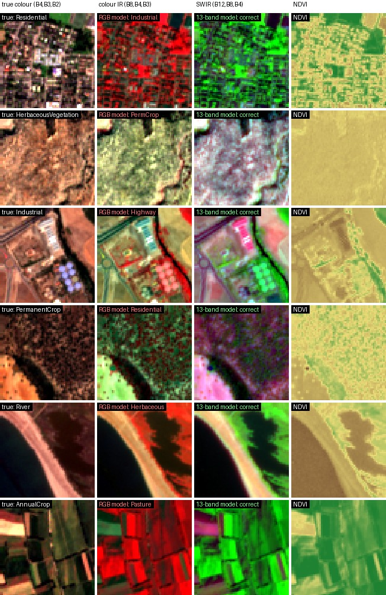
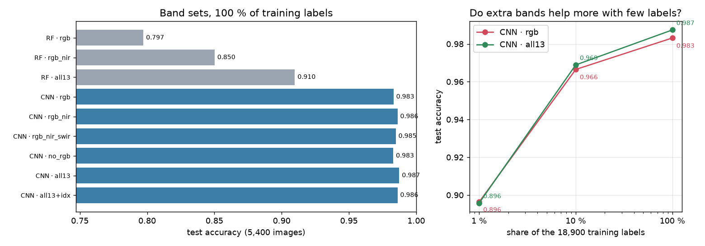
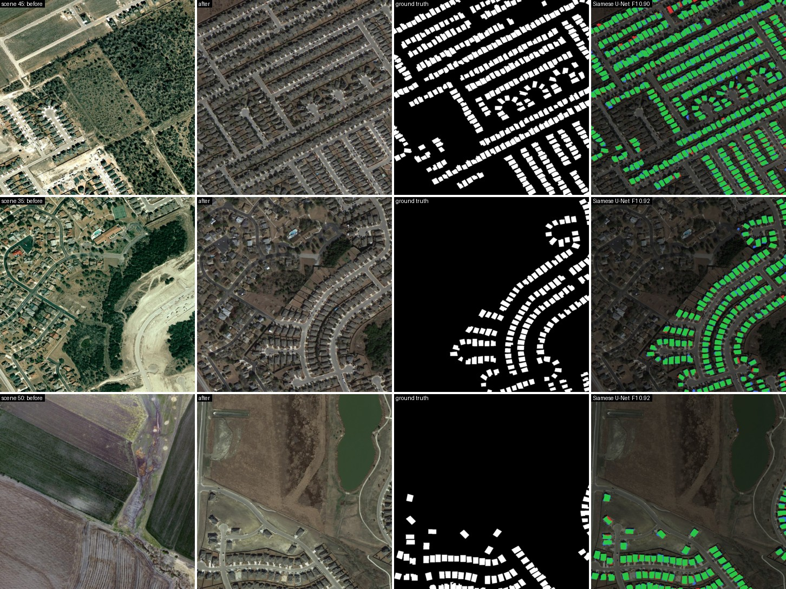
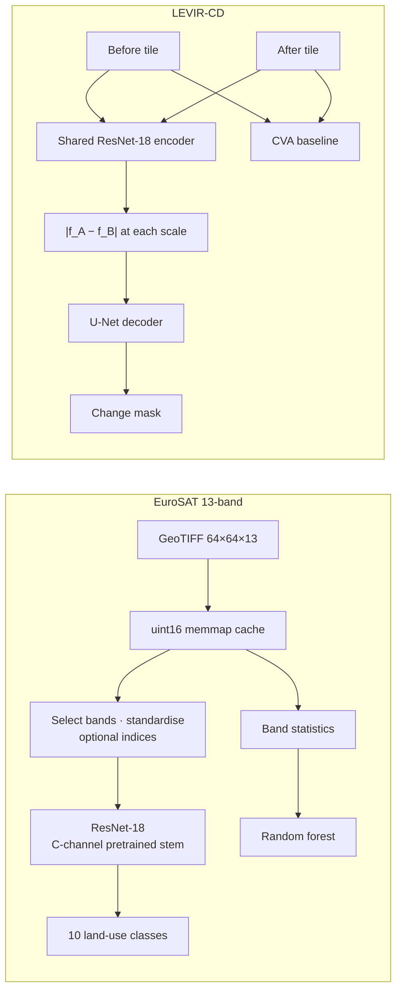

<div align="center">

# Satellite Land Use and Change Detection

Land-use classification on all 13 Sentinel-2 bands (EuroSAT) with a band-ablation study, and building change detection on LEVIR-CD with a Siamese U-Net compared against classical Change Vector Analysis.

[](https://github.com/haroonkhan02/satellite-landuse-multispectral/actions/workflows/ci.yml)




<sub>Test patches the RGB model misclassifies and the 13-band model gets right: true colour, colour infrared, SWIR, NDVI.</sub>

</div>

## What it does

- Classifies 64×64 EuroSAT patches into 10 land-use classes with an ImageNet ResNet-18 whose first layer is rebuilt for any number of Sentinel-2 bands.
- Runs a band ablation (9 band sets, a spectra-only random-forest baseline, and 1 %/10 %/100 % label budgets) on one fixed split, with a McNemar test for the main comparison.
- Detects new buildings between two aerial images with a weight-sharing Siamese U-Net, and compares it with Change Vector Analysis.
- Produces spectral signatures, band-occlusion importance, false-colour composites and full scenes stitched back from tiles. A Gradio demo covers both tasks.

## Results

### EuroSAT land use: which bands matter?

Stratified 70/10/20 split of 27,000 patches, test = 5,400. The CNN is trained for 8 epochs; the random forest sees only per-band statistics, so spectra without spatial context.

| Model | Bands | Test accuracy | Macro F1 |
|---|---|---|---|
| Random forest | RGB | 0.797 | 0.789 |
| Random forest | RGB + NIR | 0.850 | 0.845 |
| Random forest | all 13 | 0.910 | 0.905 |
| ResNet-18 | RGB | 0.983 | 0.982 |
| ResNet-18 | RGB + NIR | 0.986 | 0.986 |
| ResNet-18 | RGB + NIR + SWIR | 0.985 | 0.984 |
| ResNet-18 | 10 non-visible bands only | 0.983 | 0.982 |
| ResNet-18 | all 13 | 0.987 | 0.987 |
| ResNet-18 | all 13 + NDVI/NDWI/NDBI/NDMI | 0.986 | 0.986 |

With fewer labels the gap disappears: RGB vs. all 13 scores 0.966 vs. 0.969 with 10 % of the labels and 0.896 vs. 0.896 with 1 % (191 images). Each CNN trains in about 2 minutes on an Apple M5. The full table with train times is in [`reports/ablation.md`](reports/ablation.md).

Spectral information and spatial context are largely interchangeable here. Without spatial features the extra bands are worth 11 points; a CNN already gets 0.983 from RGB, and all 13 bands add 0.4 points (91 vs. 68 errors, exact McNemar p = 0.02). The gain is in vegetation classes, where red-edge, NIR and SWIR signatures differ more than colour: Pasture F1 0.968 → 0.978, PermanentCrop 0.965 → 0.972. I expected extra bands to help more with few labels, and they didn't, likely because the ImageNet stem only has meaningful filters for RGB.

Caveats: one seed per configuration, so differences between 0.983 and 0.987 are within run-to-run noise except for the tested RGB vs. all-13 pair. EuroSAT's random split lets neighbouring patches of one field land in train and test, which flatters every model.

<p align="center"></p>

### LEVIR-CD building change detection

Official split as 256² tiles (test = 2,048 tiles, 5.1 % changed pixels). Change-class metrics pooled over all test pixels.

| Method | F1 | IoU | Precision | Recall | ms / tile |
|---|---|---|---|---|---|
| CVA + Otsu per tile | 0.105 | 0.055 | 0.064 | 0.290 | 4.3 (CPU) |
| CVA + threshold tuned on val | 0.117 | 0.062 | 0.073 | 0.284 | 4.3 (CPU) |
| Siamese U-Net, ResNet-18 | 0.890 | 0.801 | 0.891 | 0.888 | 5.9 (MPS) |

"Change" here means new buildings, and raw pixel differences can't tell that apart from seasons, shadows, roads or a grey roof on grey soil. Tuning CVA's threshold barely helps; the learned model has seen what a building looks like in both dates. Its remaining errors are building outlines, small sheds and construction sites with an ambiguous extent. On tiles with no change it flags 50 or more pixels in 4.1 % of them. The Hugging Face mirror stores JPEGs rather than the original PNGs and the model is small, so this isn't a like-for-like comparison with papers (roughly 0.86–0.92 F1 for comparable models).

<p align="center"></p>
<p align="center"><sub>Full test scenes stitched from 16 tiles: before, after, ground truth, prediction (green correct, red missed, blue false alarm). In the bottom scene fields became a lake and roads appeared; the network marks only the houses.</sub></p>

## How it works



The 13-band stem is built from the ImageNet one: B04/B03/B02 take the red/green/blue filters, every other band starts from their mean, and the kernel is scaled by 3/C so the first activations keep their pretrained size. For change detection the decoder gets the absolute feature difference of the two dates at every scale, so unchanged content cancels and model(A, B) equals model(B, A). Training swaps the dates at random as a free augmentation. The loss is half BCE (pos_weight 3) and half soft Dice.

## Getting started

```bash
git clone https://github.com/haroonkhan02/satellite-landuse-multispectral.git
cd satellite-landuse-multispectral
uv venv --python 3.12 && source .venv/bin/activate
uv pip install -e ".[demo,dev]"

satland-download all             # EuroSAT 2.1 GB + LEVIR-CD 345 MB
satland-prepare                  # memmap cache and band statistics

satland-train --bands all13      # one classifier, ~2.4 min on an M5
satland-ablation                 # every row of the table, ~30 min
satland-evaluate --models rgb rgb_nir all13
satland-cd-train                 # Siamese U-Net, ~38 min
satland-cd-evaluate
satland-demo                     # Gradio app
```

Weights aren't committed; the commands above reproduce them. Band sets are `rgb`, `rgb_nir`, `rgb_nir_swir`, `no_rgb`, `all13`, any of them with `+idx`, or a list such as `--bands B04,B08,B11`. Tests use synthetic spectra and tiles: `pytest` and `ruff check .`.

## Repository structure

```text
satellite-landuse-multispectral/
├── src/satland/
│   ├── bands.py          # Sentinel-2 band table, band sets, indices, composites
│   ├── download.py       # EuroSAT (Zenodo) and LEVIR-CD (Hugging Face)
│   ├── eurosat.py        # memmap cache, split, band stats, batches
│   ├── models.py         # ResNet with a C-channel pretrained stem
│   ├── train_cls.py      # classifier training
│   ├── ablation.py       # band ablation and random-forest baseline
│   ├── evaluate_cls.py   # per-class F1, occlusion, signatures, gallery
│   ├── levircd.py        # tiles, paired augmentation with date swap
│   ├── change.py         # Siamese U-Net, metrics, CVA baseline
│   ├── train_cd.py       # change-detection training
│   ├── evaluate_cd.py    # test metrics, gallery, stitched scenes
│   ├── demo.py           # Gradio app
│   ├── plots.py  viz.py  # figures, composites, overlays
│   └── config.py         # paths, constants, YAML configs
├── configs/              # training configs, split, band statistics
├── tests/                # synthetic data, no download needed
├── reports/              # results, histories, figures
└── data/  models/        # datasets and weights (git-ignored)
```

## Design decisions

| Decision | Why |
|---|---|
| Rebuild the first conv rather than project bands to 3 channels | Keeps every band past the stem and reuses RGB filters where they mean something. |
| Random forest on band statistics as a baseline | Separates the value of spectra from the value of spatial context. |
| uint16 memmap with preprocessing on the GPU | 27,000 TIFF reads per epoch would dominate; with the cache an epoch takes about 20 s. |
| Band occlusion read as reliance, not information | Blanking B2–B4 costs 12–16 points but one NIR band under 2, because the five NIR/red-edge bands are correlated and cover for each other. |
| Absolute feature difference for change | Cancels unchanged content and makes the model order-invariant. |
| Pooled change-class F1, not accuracy | 95 % of pixels don't change; predicting nothing scores 0.95 accuracy. |
| CVA also given a val-tuned threshold | Gives the classical method its best fair chance. |

## Limitations and future work

- A geographic train/test split for EuroSAT would measure how much spatial leakage inflates every number.
- Several seeds and longer schedules to put error bars on the ablation (validation accuracy was still rising at epoch 8).
- Multispectral self-supervised weights (e.g. SSL4EO-S12) so non-RGB bands get real pretrained filters, then repeat the low-label study.
- An early-fusion baseline (implemented, not trained) and a transformer change model at the same budget.
- Change detection on Sentinel-2 time series (OSCD) to connect the two halves.

## Acknowledgements

[EuroSAT](https://github.com/phelber/EuroSAT) (Helber et al., IEEE JSTARS 2019; MS version from [Zenodo](https://zenodo.org/records/7711810)) · [LEVIR-CD](https://justchenhao.github.io/LEVIR/) (Chen & Shi, Remote Sensing 2020, academic use; 256 px tiles from [ericyu/LEVIRCD_Cropped256](https://huggingface.co/datasets/ericyu/LEVIRCD_Cropped256)) · Copernicus Sentinel-2 data (ESA) · [segmentation_models.pytorch](https://github.com/qubvel-org/segmentation_models.pytorch)

## License

[MIT](LICENSE) © Muhammad Haroon Khan
